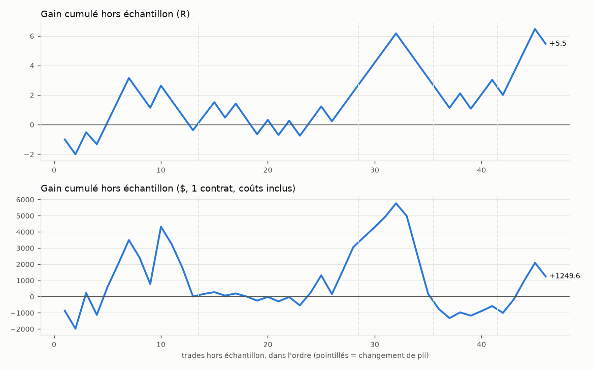

# Optimiseur conjoint entrée × stop × sortie — rapport

*Généré le 15/10/2026 19:11 — unité 15 min — symboles API — vrais prix exacts (API)*

## Verdict : NON CONCLUANT

- Seulement 46 trades hors échantillon, moins que le minimum exigé (100) : il faut un historique plus long avant de conclure quoi que ce soit.
- ÉCHEC : borne basse de l'IC 95 % du R moyen hors échantillon > 0 ([-0.236 ; +0.417])
- ÉCHEC : Probabilistic Sharpe hors échantillon >= 0,95 (0.74)
- OK : SPA de Hansen p <= 0.05 (0.037)
- ÉCHEC : Deflated Sharpe >= 0.95 (0.18)

## Données

- API 15 min, 2026-09-16 -> 2026-10-12, 2466 barres, vrais prix exacts (API)
- 25 jours de bourse au total. Chauffe coupée : 150 barres par série.
- Coûts : 1 tick de glissement par côté + 1.25 $ par contrat et par côté ; valeur du point : API 20 $.

## Méthode

- Recherche : 3340 réglages tirés au hasard (+ grille réduite par déclencheur) puis, à chaque pli, tous les voisins des 25 meilleurs : **4971 réglages distincts évalués**, 404 configurations de trade simulées.
- Walk-forward glissant : 12 jours d'apprentissage, 3 jours de test, 5 plis. données courtes (25 jours de bourse) : fenêtres ramenées de 60/10 à 12/3 jours
- Sélection d'une **zone stable** : score = quantile 25 % du score (t) sur le réglage et ses voisins (une valeur voisine de chaque paramètre ordonné) ; au moins 30 trades en apprentissage.
- Biais de sélection : Deflated Sharpe Ratio (N = essais distincts) et Reality Check de White / SPA de Hansen (bootstrap stationnaire par jour, 1000 tirages).
- Intervalles de confiance : bootstrap par JOUR (2000 tirages) ; ruine : Monte Carlo, 1 % de risque par trade, ruine = -30 % du capital, horizon 250 trades.

## Résultat hors échantillon (plis de test concaténés)

| Mesure | Valeur | IC 95 % (bootstrap par jour) |
|---|---|---|
| Trades | 46 | minimum exigé : 100 |
| R moyen par trade | +0.119 | [-0.236 ; +0.417] |
| Profit factor | 1.25 | [0.63 ; 2.20] |
| Gagnants | 52 % | [36 % ; 67 %] |
| Drawdown max (R) | 5.1 | [2.5 ; 13.9] |
| Total (R) | +5.5 | [-10.0 ; +19.8] |
| Total ($, 1 contrat) | +1250 | |
| P(R moyen > 0) | 0.74 | |
| Probabilistic Sharpe (journalier, vs 0) | 0.74 | |
| Probabilité de ruine (Monte Carlo) | 0.1 % | drawdown médian 11 %, 95e centile 21 % |



### Choix de chaque pli

| Pli | Apprentissage | Test | Réglage choisi | Plateau | Trades appr. | Trades test | R moyen test |
|---|---|---|---|---|---|---|---|
| 1 | 18/09/26 → 29/09/26 | 30/09/26 → 02/10/26 | climax — marché stop 1.5ATR obj 1.5R sortie Heishi | +0.98 | 37 | 13 | -0.029 |
| 2 | 21/09/26 → 02/10/26 | 03/10/26 → 05/10/26 | niveau — marché stop 1.5ATR obj 1R BE 1R | +0.97 | 55 | 15 | +0.173 |
| 3 | 24/09/26 → 05/10/26 | 06/10/26 → 08/10/26 | niveau pas contre climax — marché stop 1.5ATR obj 1R BE 1R | +0.98 | 41 | 7 | +0.134 |
| 4 | 27/09/26 → 08/10/26 | 09/10/26 → 11/10/26 | niveau pas contre climax — marché stop 1.5ATR obj 1R BE 1R sortie Heishi | +1.40 | 39 | 6 | -0.022 |
| 5 | 30/09/26 → 11/10/26 | 12/10/26 → 12/10/26 | rebond_detector — marché stop 1.5ATR obj 1.5R sortie Heishi | +0.46 | 56 | 5 | +0.488 |

Stabilité : 0 pli(s) sur 5 ont choisi le réglage final, 0 un de ses voisins ; déclencheurs choisis : climax ×1, niveau ×3, rebond_detector ×1.

## Biais de sélection (échantillon complet)

- Reality Check de White : p = 0.267 ; SPA de Hansen : p = 0.037 (H0 : aucun des 1968 réglages ne bat « ne rien faire »).
- Deflated Sharpe du réglage retenu : 0.18 (Sharpe journalier 0.504 ; Sharpe attendu du meilleur de 1364 essais distincts sans talent : 0.665 ; 4971 réglages évalués, dont 1364 aux rendements distincts avec assez de trades).

## Meilleurs réglages sur tout l'historique (zone stable, EN ÉCHANTILLON)

Classés par score de plateau. Ces chiffres sont mesurés sur les données qui ont servi au choix : ils sont optimistes par construction. Seul le résultat hors échantillon ci-dessus fait foi.

| # | Réglage | Pine ? | Plateau | Trades | R moyen [IC 95 %] | PF [IC 95 %] | DD max R | Médiane voisins |
|---|---|---|---|---|---|---|---|---|
| 1 | niveau TREND 60 ADX>=20 ATRrel>=0.9 — marché stop 1.5ATR obj 1R | non | +1.94 | 52 | +0.334 [+0.118 ; +0.562] | 2.01 [1.27 ; 3.61] | 3.1 | — |
| 2 | niveau TREND 60 Det 1 — marché stop 1.5ATR obj 1R | oui | +1.93 | 54 | +0.320 [+0.050 ; +0.536] | 1.95 [1.10 ; 3.35] | 3.1 | — |
| 3 | niveau long seulement EMA50 Det 1 pas contre climax — marché stop 1ATR obj 1R sortie Heishi | oui | +1.93 | 36 | +0.423 [+0.082 ; +0.745] | 2.49 [1.18 ; 7.14] | 3.1 | — |
| 4 | niveau TREND 60 ADX>=20 Det 1 — marché stop 1.5ATR obj 1R | oui | +1.84 | 52 | +0.333 [+0.074 ; +0.524] | 2.00 [1.16 ; 3.23] | 3.1 | — |
| 5 | niveau TREND 60 Det 1 pas contre climax — marché stop 1.5ATR obj 1R | oui | +1.80 | 38 | +0.408 [+0.098 ; +0.683] | 2.39 [1.22 ; 5.44] | 3.0 | — |
| 6 | niveau ATRrel>=0.9 Det 1 — marché stop 1.5ATR obj 1R | non | +1.67 | 41 | +0.356 [+0.099 ; +0.577] | 2.11 [1.22 ; 3.78] | 4.0 | — |
| 7 | climax EMA50 ATRrel>=0.9 — marché stop 2ATR obj 1.5R sortie Heishi | non | +1.67 | 42 | +0.456 [+0.086 ; +0.813] | 2.15 [1.16 ; 4.14] | 3.0 | — |
| 8 | niveau TREND 60 ADX>=20 pas contre climax — marché stop 1.5ATR obj 1R | oui | +1.57 | 59 | +0.306 [+0.084 ; +0.485] | 1.89 [1.18 ; 2.91] | 4.0 | — |
| 9 | climax EMA50 ATRrel>=0.9 — marché stop 1.5ATR obj 2R sortie Heishi | non | +1.57 | 44 | +0.563 [+0.125 ; +1.018] | 2.18 [1.20 ; 4.14] | 6.0 | — |
| 10 | niveau long seulement TREND 240 — marché stop 1.5ATR obj 1R BE 1R sortie Heishi | oui | +1.31 | 48 | +0.325 [+0.162 ; +0.491] | 1.99 [1.39 ; 2.97] | 2.1 | — |

## Réglages à recopier dans STRATEGIE_V1.pine

**Aucun réglage n'est validé.** Le bloc ci-dessous est seulement le meilleur plateau sur l'historique complet, à tester au testeur de TradingView sur un historique long — PAS à trader.

*Meilleure zone stable (espace complet)* — niveau TREND 60 ADX>=20 ATRrel>=0.9 — marché stop 1.5ATR obj 1R

```pine
// Onglet Paramètres de « Stratégie V1 », ou défauts des input.* dans STRATEGIE_V1.pine
preset         = "Personnalisé"               // « Préréglage »
e_sens_in      = "Les deux"                   // « Sens autorisé »
e_sigOn_in     = false                        // « Entrée sur flèche Signator »
e_sigNiv_in    = "Fort seulement"             // « Niveau des flèches »
e_heiOn_in     = false                        // « Entrée sur changement de couleur Heishinator »
e_tlOn_in      = false                        // « Entrée sur cassure de trendline (Breakator) »
e_lvlOn_in     = true                         // « Entrée sur cassure de niveau (sessions / Monday) »
e_lvlAs        = true                         // « Niveaux Asie »
e_lvlLd        = true                         // « Londres »
e_lvlUs        = true                         // « US »
e_lvlMon       = true                         // « Monday »
e_lvlSrc       = "Heiken Ashi (comme l'indicateur)" // « Niveaux mesurés sur »
lv_brk         = "Clôture"                    // « Cassure de niveau (sessions, Monday) quand »
e_clxOn_in     = false                        // « Entrée sur climax (BUY = long, SELL = short) »
f_feuOn_in     = false                        // « Feu de Confluence dans le sens du trade »
f_trOn_in      = true                         // « TREND d'une unité supérieure dans le sens »
f_trTf         = "60"                         // « TREND : unité »
f_emaOn_in     = false                        // « Clôture du bon côté de l'EMA50 (Moyenator 1) »
f_hrOn_in      = false                        // « Fenêtres horaires (heure de Paris) »
f_boOn         = true                         // « Blackout d'annonces sur TOUTES les entrées »
f_adxOn_in     = true                         // « ADX minimum »
f_adxMin       = 20.0                         // « ADX minimum (valeur) »
f_maxJour      = 0                            // « Trades maximum par jour (0 = illimité) »
f_detOn_in     = false                        // « Detector : place jusqu'à la zone opposée »
f_clxOn_in     = false                        // « Climax : ne jamais trader contre le dernier climax »
x_stopMode_in  = "ATR × k"                    // « Stop initial »
x_atrLen       = 14                           // « ATR (vrais prix) : période »
x_atrK_in      = 1.5                          // « Stop ATR : k »
x_tpOn_in      = true                         // « Objectif en R »
x_tpR_in       = 1.0                          // « Objectif en R (valeur) »
x_trMode_in    = "Aucun"                      // « Stop suiveur »
x_beOn_in      = false                        // « Break-even après X R »
x_oppArr_in    = false                        // « Sortie sur flèche Signator opposée (Fort ou Moyen) »
x_oppHei_in    = false                        // « Sortie sur changement Heishinator opposé »
x_finOn_in     = false                        // « Sortie en fin de séance (heure de Paris) »
// NON DISPONIBLE dans STRATEGIE_V1 (à ajouter) : filtre volatilité : ATR14 / moyenne100(ATR14) >= 0.90
```

*Meilleure zone stable 100 % transposable (réglages existants de STRATEGIE_V1)* — niveau TREND 60 ADX>=25 Det 1 — marché stop 1.5ATR obj 1R

```pine
// Onglet Paramètres de « Stratégie V1 », ou défauts des input.* dans STRATEGIE_V1.pine
preset         = "Personnalisé"               // « Préréglage »
e_sens_in      = "Les deux"                   // « Sens autorisé »
e_sigOn_in     = false                        // « Entrée sur flèche Signator »
e_sigNiv_in    = "Fort seulement"             // « Niveau des flèches »
e_heiOn_in     = false                        // « Entrée sur changement de couleur Heishinator »
e_tlOn_in      = false                        // « Entrée sur cassure de trendline (Breakator) »
e_lvlOn_in     = true                         // « Entrée sur cassure de niveau (sessions / Monday) »
e_lvlAs        = true                         // « Niveaux Asie »
e_lvlLd        = true                         // « Londres »
e_lvlUs        = true                         // « US »
e_lvlMon       = true                         // « Monday »
e_lvlSrc       = "Heiken Ashi (comme l'indicateur)" // « Niveaux mesurés sur »
lv_brk         = "Clôture"                    // « Cassure de niveau (sessions, Monday) quand »
e_clxOn_in     = false                        // « Entrée sur climax (BUY = long, SELL = short) »
f_feuOn_in     = false                        // « Feu de Confluence dans le sens du trade »
f_trOn_in      = true                         // « TREND d'une unité supérieure dans le sens »
f_trTf         = "60"                         // « TREND : unité »
f_emaOn_in     = false                        // « Clôture du bon côté de l'EMA50 (Moyenator 1) »
f_hrOn_in      = false                        // « Fenêtres horaires (heure de Paris) »
f_boOn         = true                         // « Blackout d'annonces sur TOUTES les entrées »
f_adxOn_in     = true                         // « ADX minimum »
f_adxMin       = 25.0                         // « ADX minimum (valeur) »
f_maxJour      = 0                            // « Trades maximum par jour (0 = illimité) »
f_detOn_in     = true                         // « Detector : place jusqu'à la zone opposée »
f_detK         = 1.0                          // « Detector : distance minimum (× ATR14) »
f_clxOn_in     = false                        // « Climax : ne jamais trader contre le dernier climax »
x_stopMode_in  = "ATR × k"                    // « Stop initial »
x_atrLen       = 14                           // « ATR (vrais prix) : période »
x_atrK_in      = 1.5                          // « Stop ATR : k »
x_tpOn_in      = true                         // « Objectif en R »
x_tpR_in       = 1.0                          // « Objectif en R (valeur) »
x_trMode_in    = "Aucun"                      // « Stop suiveur »
x_beOn_in      = false                        // « Break-even après X R »
x_oppArr_in    = false                        // « Sortie sur flèche Signator opposée (Fort ou Moyen) »
x_oppHei_in    = false                        // « Sortie sur changement Heishinator opposé »
x_finOn_in     = false                        // « Sortie en fin de séance (heure de Paris) »
```

## Limites

- Une position à la fois par graphique, pas de renversement ; un trade encore ouvert en fin de série est abandonné.
- Remplissages prudents (objectif dépassé d'un tick, stop et objectif dans la même barre = stop) : le testeur TradingView remplit un peu mieux les objectifs.
- Vrais prix reconstitués : fiables en 15 min (±0,1-0,2 R), PAS en 1-3 min. Fournir les bougies standard du même graphique (mode b) supprime cette erreur.
- Le Feu de Confluence n'est qu'un PROXY à 12 voix (le Pine en a 29) : désactivé par défaut.
- Swing (stop/suiveur) : pivots stricts des deux côtés (ta.pivotlow peut traiter les égalités autrement).
- Cassure de niveau (sessions/Monday) : dernier niveau terminé de chaque session (le Pine garde 2 jours).
- Les trades d'un pli de test sont ceux du réglage choisi, joué en continu : une position ouverte par le réglage du pli précédent n'est pas reportée.
- données courtes (25 jours de bourse) : fenêtres ramenées de 60/10 à 12/3 jours

*Temps de calcul : 4 s au total (simulation des trades 2 s).*
