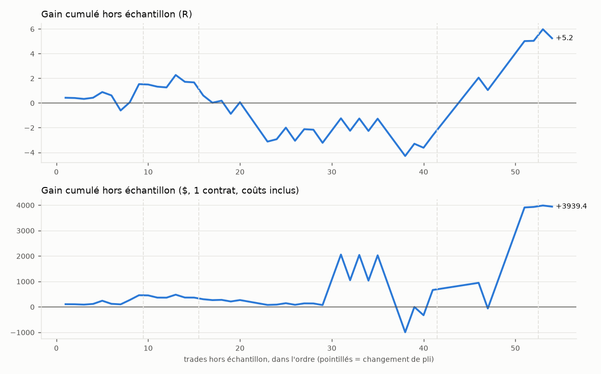

# Optimiseur conjoint entrée × stop × sortie — rapport

*Généré le 15/10/2026 19:11 — unité 15 min — symboles MES, NQ — vrais prix reconstitués depuis le Heiken Ashi*

## Verdict : NON CONCLUANT

- Seulement 54 trades hors échantillon, moins que le minimum exigé (100) : il faut un historique plus long avant de conclure quoi que ce soit.
- ÉCHEC : borne basse de l'IC 95 % du R moyen hors échantillon > 0 ([-0.152 ; +0.371])
- ÉCHEC : Probabilistic Sharpe hors échantillon >= 0,95 (0.76)
- ÉCHEC : SPA de Hansen p <= 0.05 (0.163)
- ÉCHEC : Deflated Sharpe >= 0.95 (0.00)

## Données

- MES 15 min, 2026-04-29 -> 2026-07-07, 4498 barres, vrais prix reconstitués depuis le HA, SANS volume (pas de climax/Detector)
- MES 15 min, 2026-09-15 -> 2026-10-15, 2068 barres, vrais prix reconstitués depuis le HA
- NQ 15 min, 2026-09-18 -> 2026-10-15, 1780 barres, vrais prix reconstitués depuis le HA
- 70 jours de bourse au total. Chauffe coupée : 150 barres par série.
- Coûts : 1 tick de glissement par côté + 1.25 $ par contrat et par côté ; valeur du point : MES 5 $, NQ 20 $.

## Méthode

- Recherche : 3340 réglages tirés au hasard (+ grille réduite par déclencheur) puis, à chaque pli, tous les voisins des 25 meilleurs : **5216 réglages distincts évalués**, 787 configurations de trade simulées.
- Walk-forward glissant : 35 jours d'apprentissage, 8 jours de test, 5 plis. données courtes (70 jours de bourse) : fenêtres ramenées de 60/10 à 35/8 jours
- Sélection d'une **zone stable** : score = quantile 25 % du score (t) sur le réglage et ses voisins (une valeur voisine de chaque paramètre ordonné) ; au moins 30 trades en apprentissage.
- Biais de sélection : Deflated Sharpe Ratio (N = essais distincts) et Reality Check de White / SPA de Hansen (bootstrap stationnaire par jour, 1000 tirages).
- Intervalles de confiance : bootstrap par JOUR (2000 tirages) ; ruine : Monte Carlo, 1 % de risque par trade, ruine = -30 % du capital, horizon 250 trades.

## Résultat hors échantillon (plis de test concaténés)

| Mesure | Valeur | IC 95 % (bootstrap par jour) |
|---|---|---|
| Trades | 54 | minimum exigé : 100 |
| R moyen par trade | +0.097 | [-0.152 ; +0.371] |
| Profit factor | 1.30 | [0.66 ; 3.06] |
| Gagnants | 52 % | [38 % ; 67 %] |
| Drawdown max (R) | 6.6 | [1.6 ; 13.6] |
| Total (R) | +5.2 | [-9.1 ; +19.2] |
| Total ($, 1 contrat) | +3939 | |
| P(R moyen > 0) | 0.79 | |
| Probabilistic Sharpe (journalier, vs 0) | 0.76 | |
| Probabilité de ruine (Monte Carlo) | 0.0 % | drawdown médian 10 %, 95e centile 18 % |



### Choix de chaque pli

| Pli | Apprentissage | Test | Réglage choisi | Plateau | Trades appr. | Trades test | R moyen test |
|---|---|---|---|---|---|---|---|
| 1 | 01/05/26 → 18/06/26 | 19/06/26 → 30/06/26 | niveau us — limite 2b stop swing obj 1.5R BE 1R sortie Heishi fin 21:45 max 32b | +2.25 | 34 | 9 | +0.170 |
| 2 | 13/05/26 → 30/06/26 | 01/07/26 → 18/09/26 | niveau us — limite 2b stop swing obj 2R BE 1R sortie Heishi fin 21:45 max 32b | +1.94 | 36 | 6 | +0.024 |
| 3 | 25/05/26 → 18/09/26 | 21/09/26 → 30/09/26 | niveau us ATRrel>=0.9 max 3/j — limite 2b stop fixe#1 obj 1R BE 1R sortie Heishi fin 21:45 max 32b | +1.69 | 41 | 26 | -0.165 |
| 4 | 04/06/26 → 30/09/26 | 01/10/26 → 12/10/26 | niveau us ATRrel>=0.9 Det 1 — limite 4b stop fixe#1 obj 1R BE 1R sortie Heishi fin 21:45 max 32b | +2.14 | 64 | 11 | +0.697 |
| 5 | 16/06/26 → 12/10/26 | 13/10/26 → 15/10/26 | niveau us ATRrel>=0.9 Det 1 — limite 4b stop fixe#1 obj 1R BE 1R sortie Heishi fin 21:45 max 16b | +2.38 | 69 | 2 | +0.104 |

Stabilité : 0 pli(s) sur 5 ont choisi le réglage final, 1 un de ses voisins ; déclencheurs choisis : niveau ×5.

## Biais de sélection (échantillon complet)

- Reality Check de White : p = 0.844 ; SPA de Hansen : p = 0.163 (H0 : aucun des 3161 réglages ne bat « ne rien faire »).
- Deflated Sharpe du réglage retenu : 0.00 (Sharpe journalier 0.367 ; Sharpe attendu du meilleur de 2367 essais distincts sans talent : 0.734 ; 5216 réglages évalués, dont 2367 aux rendements distincts avec assez de trades).

## Meilleurs réglages sur tout l'historique (zone stable, EN ÉCHANTILLON)

Classés par score de plateau. Ces chiffres sont mesurés sur les données qui ont servi au choix : ils sont optimistes par construction. Seul le résultat hors échantillon ci-dessus fait foi.

| # | Réglage | Pine ? | Plateau | Trades | R moyen [IC 95 %] | PF [IC 95 %] | DD max R | Médiane voisins |
|---|---|---|---|---|---|---|---|---|
| 1 | niveau us ATRrel>=0.9 max 3/j Det 1 — limite 2b stop fixe#1 obj 1R BE 1R sortie Heishi fin 21:45 max 32b | non | +2.67 | 91 | +0.297 [+0.120 ; +0.484] | 1.99 [1.31 ; 3.34] | 2.7 | +2.90 |
| 2 | niveau us ADX>=20 Det 1 pas contre climax — limite 2b stop swing obj 1R BE 1R fin 21:45 | non | +2.60 | 57 | +0.275 [+0.114 ; +0.432] | 3.08 [1.59 ; 7.63] | 1.7 | +3.07 |
| 3 | niveau us ADX>=20 Det 1 pas contre climax — limite 2b stop swing obj 1R BE 1R sortie flèche fin 21:45 | non | +2.53 | 58 | +0.258 [+0.105 ; +0.422] | 2.85 [1.51 ; 6.44] | 1.7 | +2.92 |
| 4 | niveau us Det 1 pas contre climax — limite 2b stop swing obj 1R BE 1R fin 21:45 | non | +2.52 | 67 | +0.263 [+0.100 ; +0.420] | 2.62 [1.44 ; 5.20] | 2.7 | +2.98 |
| 5 | niveau us max 3/j Det 1 pas contre climax — limite 2b stop swing obj 1R BE 1R fin 21:45 | non | +2.46 | 66 | +0.265 [+0.104 ; +0.438] | 2.61 [1.40 ; 5.81] | 2.7 | +2.95 |
| 6 | niveau us ATRrel>=0.9 Det 1 — limite 2b stop fixe#1 obj 1R BE 1R sortie Heishi fin 21:45 max 16b | non | +2.44 | 101 | +0.281 [+0.111 ; +0.460] | 1.95 [1.29 ; 3.22] | 3.0 | +2.97 |
| 7 | niveau us ATRrel>=0.9 Det 1 — limite 2b stop fixe#1 obj 1R BE 1R fin 21:45 max 16b | non | +2.43 | 101 | +0.281 [+0.111 ; +0.460] | 1.95 [1.29 ; 3.18] | 2.8 | +2.96 |
| 8 | niveau us ATRrel>=0.9 Det 1 — limite 2b stop fixe#1 obj 1R sortie Heishi fin 21:45 max 16b | non | +2.41 | 101 | +0.281 [+0.116 ; +0.456] | 1.92 [1.30 ; 3.12] | 3.7 | +2.93 |

## Réglages à recopier dans STRATEGIE_V1.pine

**Aucun réglage n'est validé.** Le bloc ci-dessous est seulement le meilleur plateau sur l'historique complet, à tester au testeur de TradingView sur un historique long — PAS à trader.

*Meilleure zone stable (espace complet)* — niveau us ATRrel>=0.9 max 3/j Det 1 — limite 2b stop fixe#1 obj 1R BE 1R sortie Heishi fin 21:45 max 32b

```pine
// Onglet Paramètres de « Stratégie V1 », ou défauts des input.* dans STRATEGIE_V1.pine
preset         = "Personnalisé"               // « Préréglage »
e_sens_in      = "Les deux"                   // « Sens autorisé »
e_sigOn_in     = false                        // « Entrée sur flèche Signator »
e_sigNiv_in    = "Fort seulement"             // « Niveau des flèches »
e_heiOn_in     = false                        // « Entrée sur changement de couleur Heishinator »
e_tlOn_in      = false                        // « Entrée sur cassure de trendline (Breakator) »
e_lvlOn_in     = true                         // « Entrée sur cassure de niveau (sessions / Monday) »
e_lvlAs        = true                         // « Niveaux Asie »
e_lvlLd        = true                         // « Londres »
e_lvlUs        = true                         // « US »
e_lvlMon       = true                         // « Monday »
e_lvlSrc       = "Heiken Ashi (comme l'indicateur)" // « Niveaux mesurés sur »
lv_brk         = "Clôture"                    // « Cassure de niveau (sessions, Monday) quand »
e_clxOn_in     = false                        // « Entrée sur climax (BUY = long, SELL = short) »
f_feuOn_in     = false                        // « Feu de Confluence dans le sens du trade »
f_trOn_in      = false                        // « TREND d'une unité supérieure dans le sens »
f_emaOn_in     = false                        // « Clôture du bon côté de l'EMA50 (Moyenator 1) »
f_hrOn_in      = true                         // « Fenêtres horaires (heure de Paris) »
f_hr1On_in     = true                         // « Plage 1 »
f_hr1_in       = "1530-2200"                  // « Plage 1 (session) »
f_hr2On_in     = false                        // « Plage 2 »
f_boOn         = true                         // « Blackout d'annonces sur TOUTES les entrées »
f_adxOn_in     = false                        // « ADX minimum »
f_maxJour      = 3                            // « Trades maximum par jour (0 = illimité) »
f_detOn_in     = true                         // « Detector : place jusqu'à la zone opposée »
f_detK         = 1.0                          // « Detector : distance minimum (× ATR14) »
f_clxOn_in     = false                        // « Climax : ne jamais trader contre le dernier climax »
x_stopMode_in  = "Fixe (points)"              // « Stop initial »
x_atrLen       = 14                           // « ATR (vrais prix) : période »
x_fixPts       = 12.0                         // « Stop fixe (points) sur MES »
x_fixPts       = 50.0                         // « Stop fixe (points) sur NQ »
x_tpOn_in      = true                         // « Objectif en R »
x_tpR_in       = 1.0                          // « Objectif en R (valeur) »
x_trMode_in    = "Aucun"                      // « Stop suiveur »
x_beOn_in      = true                         // « Break-even après X R »
x_beR          = 1.0                          // « Break-even (R) »
x_beTk         = 1                            // « Break-even : ticks »
x_oppArr_in    = false                        // « Sortie sur flèche Signator opposée (Fort ou Moyen) »
x_oppHei_in    = true                         // « Sortie sur changement Heishinator opposé »
x_finOn_in     = true                         // « Sortie en fin de séance (heure de Paris) »
x_finH         = 21                           // « h »
x_finM         = 45                           // « min »
// NON DISPONIBLE dans STRATEGIE_V1 (à ajouter) : entrée à cours limité au milieu de la bougie signal, valable 2 barres
// NON DISPONIBLE dans STRATEGIE_V1 (à ajouter) : filtre volatilité : ATR14 / moyenne100(ATR14) >= 0.90
// NON DISPONIBLE dans STRATEGIE_V1 (à ajouter) : sortie au temps : 32 barres
```

*Meilleure zone stable 100 % transposable (réglages existants de STRATEGIE_V1)* — niveau TREND 60 us ADX>=20 max 3/j Det 1 — marché stop swing obj 1R suiveur 2ATR@1R BE 1R sortie flèche sortie Heishi fin 21:45

```pine
// Onglet Paramètres de « Stratégie V1 », ou défauts des input.* dans STRATEGIE_V1.pine
preset         = "Personnalisé"               // « Préréglage »
e_sens_in      = "Les deux"                   // « Sens autorisé »
e_sigOn_in     = false                        // « Entrée sur flèche Signator »
e_sigNiv_in    = "Fort seulement"             // « Niveau des flèches »
e_heiOn_in     = false                        // « Entrée sur changement de couleur Heishinator »
e_tlOn_in      = false                        // « Entrée sur cassure de trendline (Breakator) »
e_lvlOn_in     = true                         // « Entrée sur cassure de niveau (sessions / Monday) »
e_lvlAs        = true                         // « Niveaux Asie »
e_lvlLd        = true                         // « Londres »
e_lvlUs        = true                         // « US »
e_lvlMon       = true                         // « Monday »
e_lvlSrc       = "Heiken Ashi (comme l'indicateur)" // « Niveaux mesurés sur »
lv_brk         = "Clôture"                    // « Cassure de niveau (sessions, Monday) quand »
e_clxOn_in     = false                        // « Entrée sur climax (BUY = long, SELL = short) »
f_feuOn_in     = false                        // « Feu de Confluence dans le sens du trade »
f_trOn_in      = true                         // « TREND d'une unité supérieure dans le sens »
f_trTf         = "60"                         // « TREND : unité »
f_emaOn_in     = false                        // « Clôture du bon côté de l'EMA50 (Moyenator 1) »
f_hrOn_in      = true                         // « Fenêtres horaires (heure de Paris) »
f_hr1On_in     = true                         // « Plage 1 »
f_hr1_in       = "1530-2200"                  // « Plage 1 (session) »
f_hr2On_in     = false                        // « Plage 2 »
f_boOn         = true                         // « Blackout d'annonces sur TOUTES les entrées »
f_adxOn_in     = true                         // « ADX minimum »
f_adxMin       = 20.0                         // « ADX minimum (valeur) »
f_maxJour      = 3                            // « Trades maximum par jour (0 = illimité) »
f_detOn_in     = true                         // « Detector : place jusqu'à la zone opposée »
f_detK         = 1.0                          // « Detector : distance minimum (× ATR14) »
f_clxOn_in     = false                        // « Climax : ne jamais trader contre le dernier climax »
x_stopMode_in  = "Dernier swing + marge"      // « Stop initial »
x_atrLen       = 14                           // « ATR (vrais prix) : période »
x_atrK_in      = 2.0                          // « Stop ATR : k »
x_swL          = 5                            // « Swing : barres à gauche »
x_swR          = 2                            // « Swing : barres à droite »
x_swMarge      = 2                            // « Swing : marge (ticks) »
x_tpOn_in      = true                         // « Objectif en R »
x_tpR_in       = 1.0                          // « Objectif en R (valeur) »
x_trMode_in    = "ATR"                        // « Stop suiveur »
x_trK          = 2.0                          // « Suiveur ATR : k »
x_trAct        = 1.0                          // « Suiveur actif après (R) »
x_beOn_in      = true                         // « Break-even après X R »
x_beR          = 1.0                          // « Break-even (R) »
x_beTk         = 1                            // « Break-even : ticks »
x_oppArr_in    = true                         // « Sortie sur flèche Signator opposée (Fort ou Moyen) »
x_oppHei_in    = true                         // « Sortie sur changement Heishinator opposé »
x_finOn_in     = true                         // « Sortie en fin de séance (heure de Paris) »
x_finH         = 21                           // « h »
x_finM         = 45                           // « min »
```

## Limites

- Une position à la fois par graphique, pas de renversement ; un trade encore ouvert en fin de série est abandonné.
- Remplissages prudents (objectif dépassé d'un tick, stop et objectif dans la même barre = stop) : le testeur TradingView remplit un peu mieux les objectifs.
- Vrais prix reconstitués : fiables en 15 min (±0,1-0,2 R), PAS en 1-3 min. Fournir les bougies standard du même graphique (mode b) supprime cette erreur.
- Le Feu de Confluence n'est qu'un PROXY à 12 voix (le Pine en a 29) : désactivé par défaut.
- Swing (stop/suiveur) : pivots stricts des deux côtés (ta.pivotlow peut traiter les égalités autrement).
- Cassure de niveau (sessions/Monday) : dernier niveau terminé de chaque session (le Pine garde 2 jours).
- Les trades d'un pli de test sont ceux du réglage choisi, joué en continu : une position ouverte par le réglage du pli précédent n'est pas reportée.
- Séries sans volume : ni climax, ni Detector, flèches de l'original exportées à la place du Signator.
- données courtes (70 jours de bourse) : fenêtres ramenées de 60/10 à 35/8 jours

*Temps de calcul : 7 s au total (simulation des trades 4 s).*
