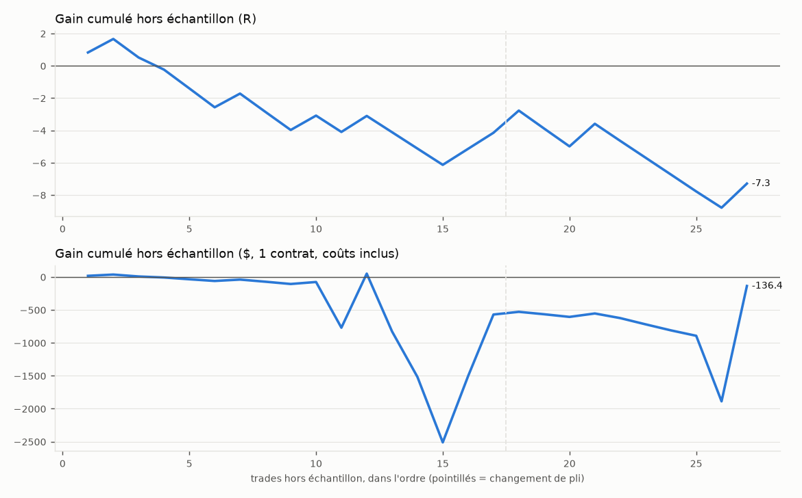

# Optimiseur conjoint entrée × stop × sortie — rapport

*Généré le 15/10/2026 19:11 — unité 15 min — symboles MES, NQ — vrais prix reconstitués depuis le Heiken Ashi*

## Verdict : NON CONCLUANT

- Seulement 27 trades hors échantillon, moins que le minimum exigé (100) : il faut un historique plus long avant de conclure quoi que ce soit.
- ÉCHEC : borne basse de l'IC 95 % du R moyen hors échantillon > 0 ([-0.437 ; -0.136])
- ÉCHEC : Probabilistic Sharpe hors échantillon >= 0,95 (0.00)
- ÉCHEC : SPA de Hansen p <= 0.05 (—)
- ÉCHEC : Deflated Sharpe >= 0.95 (0.01)

## Données

- MES 15 min, 2026-10-02 -> 2026-10-15, 809 barres, vrais prix reconstitués depuis le HA
- NQ 15 min, 2026-10-05 -> 2026-10-15, 749 barres, vrais prix reconstitués depuis le HA
- 8 jours de bourse au total. Chauffe coupée : 150 barres par série.
- Coûts : 1 tick de glissement par côté + 1.25 $ par contrat et par côté ; valeur du point : MES 5 $, NQ 20 $.

## Méthode

- Recherche : 3340 réglages tirés au hasard (+ grille réduite par déclencheur) puis, à chaque pli, tous les voisins des 25 meilleurs : **4309 réglages distincts évalués**, 457 configurations de trade simulées.
- Walk-forward glissant : 4 jours d'apprentissage, 2 jours de test, 2 plis. données courtes (8 jours de bourse) : fenêtres ramenées de 60/10 à 4/2 jours
- Sélection d'une **zone stable** : score = quantile 25 % du score (t) sur le réglage et ses voisins (une valeur voisine de chaque paramètre ordonné) ; au moins 30 trades en apprentissage.
- Biais de sélection : Deflated Sharpe Ratio (N = essais distincts) et Reality Check de White / SPA de Hansen (bootstrap stationnaire par jour, 1000 tirages).
- Intervalles de confiance : bootstrap par JOUR (2000 tirages) ; ruine : Monte Carlo, 1 % de risque par trade, ruine = -30 % du capital, horizon 250 trades.

## Résultat hors échantillon (plis de test concaténés)

| Mesure | Valeur | IC 95 % (bootstrap par jour) |
|---|---|---|
| Trades | 27 | minimum exigé : 100 |
| R moyen par trade | -0.270 | [-0.437 ; -0.136] |
| Profit factor | 0.59 | [0.42 ; 0.75] |
| Gagnants | 37 % | [29 % ; 45 %] |
| Drawdown max (R) | 10.4 | [3.7 ; 14.8] |
| Total (R) | -7.3 | [-11.9 ; -3.1] |
| Total ($, 1 contrat) | -136 | |
| P(R moyen > 0) | 0.00 | |
| Probabilistic Sharpe (journalier, vs 0) | 0.00 | |
| Probabilité de ruine (Monte Carlo) | 100.0 % | drawdown médian 51 %, 95e centile 55 % |



### Choix de chaque pli

| Pli | Apprentissage | Test | Réglage choisi | Plateau | Trades appr. | Trades test | R moyen test |
|---|---|---|---|---|---|---|---|
| 1 | 06/10/26 → 09/10/26 | 12/10/26 → 13/10/26 | rebond_detector long seulement — marché stop 1ATR obj 1R sortie Heishi | -1000000000.00 | 31 | 17 | -0.244 |
| 2 | 08/10/26 → 13/10/26 | 14/10/26 → 15/10/26 | rebond_detector Det 1 — marché stop 1.5ATR obj 1.5R sortie Heishi | -0.44 | 38 | 10 | -0.314 |

Stabilité : 0 pli(s) sur 2 ont choisi le réglage final, 0 un de ses voisins ; déclencheurs choisis : rebond_detector ×2.

## Biais de sélection (échantillon complet)

- Reality Check de White : p = — ; SPA de Hansen : p = — (H0 : aucun des 836 réglages ne bat « ne rien faire »).
- Deflated Sharpe du réglage retenu : 0.01 (Sharpe journalier 0.173 ; Sharpe attendu du meilleur de 705 essais distincts sans talent : 1.006 ; 4309 réglages évalués, dont 705 aux rendements distincts avec assez de trades).

## Meilleurs réglages sur tout l'historique (zone stable, EN ÉCHANTILLON)

Classés par score de plateau. Ces chiffres sont mesurés sur les données qui ont servi au choix : ils sont optimistes par construction. Seul le résultat hors échantillon ci-dessus fait foi.

| # | Réglage | Pine ? | Plateau | Trades | R moyen [IC 95 %] | PF [IC 95 %] | DD max R | Médiane voisins |
|---|---|---|---|---|---|---|---|---|
| 1 | rebond_detector hors_londres — marché stop fixe#1 BE 1R sortie Heishi fin 21:45 max 32b | non | -0.44 | 43 | +0.128 [-0.322 ; +0.688] | 1.30 [0.46 ; 3.69] | 9.1 | — |
| 2 | rebond_detector max 3/j — marché stop 1ATR obj 3R sortie Heishi | non | -0.51 | 37 | +0.097 [-0.455 ; +0.780] | 1.14 [0.48 ; 2.74] | 9.8 | — |
| 3 | rebond_detector hors_londres max 3/j — marché stop fixe#0 BE 1R sortie Heishi fin 21:45 max 32b | non | -0.66 | 36 | +0.275 [-0.403 ; +1.058] | 1.48 [0.40 ; 3.24] | 8.9 | — |
| 4 | rebond_detector hors_londres max 3/j Det 1 — marché stop fixe#0 BE 1R sortie Heishi fin 21:45 max 16b | non | -0.72 | 35 | +0.192 [-0.354 ; +0.933] | 1.39 [0.31 ; 3.11] | 5.1 | — |
| 5 | rebond_detector hors_londres max 3/j — marché stop fixe#0 BE 1R sortie Heishi max 16b | non | -0.73 | 37 | +0.159 [-0.436 ; +0.888] | 1.30 [0.29 ; 2.96] | 7.9 | — |
| 6 | rebond_detector long seulement ATRrel>=0.9 — marché stop 1ATR obj 1R sortie flèche sortie Heishi | non | -0.83 | 48 | +0.064 [-0.174 ; +0.369] | 1.15 [0.69 ; 2.28] | 6.1 | — |
| 7 | rebond_detector hors_londres max 3/j — marché stop fixe#0 BE 1R sortie Heishi fin 21:45 max 16b | non | -0.84 | 36 | +0.147 [-0.427 ; +0.891] | 1.27 [0.29 ; 2.85] | 7.9 | — |
| 8 | rebond_detector long seulement ATRrel>=0.9 Det 1 — marché stop 1ATR obj 1R sortie Heishi | non | -1.23 | 40 | +0.051 [-0.233 ; +0.372] | 1.11 [0.63 ; 2.27] | 5.3 | — |
| 9 | rebond_detector — marché stop 2ATR sortie Heishi | non | -1000000000.00 | 33 | +0.583 [-0.156 ; +2.541] | 2.21 [0.71 ; 8.82] | 6.8 | — |
| 10 | niveau short seulement — marché stop 1.5ATR obj 2R sortie Heishi | oui | -1000000000.00 | 30 | +0.273 [-0.292 ; +0.849] | 1.48 [0.62 ; 3.24] | 6.4 | — |

## Réglages à recopier dans STRATEGIE_V1.pine

**Aucun réglage n'est validé.** Le bloc ci-dessous est seulement le meilleur plateau sur l'historique complet, à tester au testeur de TradingView sur un historique long — PAS à trader.

*Meilleure zone stable (espace complet)* — rebond_detector hors_londres — marché stop fixe#1 BE 1R sortie Heishi fin 21:45 max 32b

```pine
// Onglet Paramètres de « Stratégie V1 », ou défauts des input.* dans STRATEGIE_V1.pine
preset         = "Personnalisé"               // « Préréglage »
e_sens_in      = "Les deux"                   // « Sens autorisé »
e_sigOn_in     = false                        // « Entrée sur flèche Signator »
e_sigNiv_in    = "Fort seulement"             // « Niveau des flèches »
e_heiOn_in     = false                        // « Entrée sur changement de couleur Heishinator »
e_tlOn_in      = false                        // « Entrée sur cassure de trendline (Breakator) »
e_lvlOn_in     = false                        // « Entrée sur cassure de niveau (sessions / Monday) »
e_clxOn_in     = false                        // « Entrée sur climax (BUY = long, SELL = short) »
f_feuOn_in     = false                        // « Feu de Confluence dans le sens du trade »
f_trOn_in      = false                        // « TREND d'une unité supérieure dans le sens »
f_emaOn_in     = false                        // « Clôture du bon côté de l'EMA50 (Moyenator 1) »
f_hrOn_in      = true                         // « Fenêtres horaires (heure de Paris) »
f_hr1On_in     = true                         // « Plage 1 »
f_hr1_in       = "1430-0800"                  // « Plage 1 (session) »
f_hr2On_in     = false                        // « Plage 2 »
f_boOn         = true                         // « Blackout d'annonces sur TOUTES les entrées »
f_adxOn_in     = false                        // « ADX minimum »
f_maxJour      = 0                            // « Trades maximum par jour (0 = illimité) »
f_detOn_in     = false                        // « Detector : place jusqu'à la zone opposée »
f_clxOn_in     = false                        // « Climax : ne jamais trader contre le dernier climax »
x_stopMode_in  = "Fixe (points)"              // « Stop initial »
x_atrLen       = 14                           // « ATR (vrais prix) : période »
x_fixPts       = 12.0                         // « Stop fixe (points) sur MES »
x_fixPts       = 50.0                         // « Stop fixe (points) sur NQ »
x_tpOn_in      = false                        // « Objectif en R »
x_trMode_in    = "Aucun"                      // « Stop suiveur »
x_beOn_in      = true                         // « Break-even après X R »
x_beR          = 1.0                          // « Break-even (R) »
x_beTk         = 1                            // « Break-even : ticks »
x_oppArr_in    = false                        // « Sortie sur flèche Signator opposée (Fort ou Moyen) »
x_oppHei_in    = true                         // « Sortie sur changement Heishinator opposé »
x_finOn_in     = true                         // « Sortie en fin de séance (heure de Paris) »
x_finH         = 21                           // « h »
x_finM         = 45                           // « min »
// NON DISPONIBLE dans STRATEGIE_V1 (à ajouter) : sortie au temps : 32 barres
// NON DISPONIBLE dans STRATEGIE_V1 (à ajouter) : déclencheur « rebond Detector »
```

*Meilleure zone stable 100 % transposable (réglages existants de STRATEGIE_V1)* — niveau — marché stop 3ATR obj 3R sortie Heishi fin 21:45

```pine
// Onglet Paramètres de « Stratégie V1 », ou défauts des input.* dans STRATEGIE_V1.pine
preset         = "Personnalisé"               // « Préréglage »
e_sens_in      = "Les deux"                   // « Sens autorisé »
e_sigOn_in     = false                        // « Entrée sur flèche Signator »
e_sigNiv_in    = "Fort seulement"             // « Niveau des flèches »
e_heiOn_in     = false                        // « Entrée sur changement de couleur Heishinator »
e_tlOn_in      = false                        // « Entrée sur cassure de trendline (Breakator) »
e_lvlOn_in     = true                         // « Entrée sur cassure de niveau (sessions / Monday) »
e_lvlAs        = true                         // « Niveaux Asie »
e_lvlLd        = true                         // « Londres »
e_lvlUs        = true                         // « US »
e_lvlMon       = true                         // « Monday »
e_lvlSrc       = "Heiken Ashi (comme l'indicateur)" // « Niveaux mesurés sur »
lv_brk         = "Clôture"                    // « Cassure de niveau (sessions, Monday) quand »
e_clxOn_in     = false                        // « Entrée sur climax (BUY = long, SELL = short) »
f_feuOn_in     = false                        // « Feu de Confluence dans le sens du trade »
f_trOn_in      = false                        // « TREND d'une unité supérieure dans le sens »
f_emaOn_in     = false                        // « Clôture du bon côté de l'EMA50 (Moyenator 1) »
f_hrOn_in      = false                        // « Fenêtres horaires (heure de Paris) »
f_boOn         = true                         // « Blackout d'annonces sur TOUTES les entrées »
f_adxOn_in     = false                        // « ADX minimum »
f_maxJour      = 0                            // « Trades maximum par jour (0 = illimité) »
f_detOn_in     = false                        // « Detector : place jusqu'à la zone opposée »
f_clxOn_in     = false                        // « Climax : ne jamais trader contre le dernier climax »
x_stopMode_in  = "ATR × k"                    // « Stop initial »
x_atrLen       = 14                           // « ATR (vrais prix) : période »
x_atrK_in      = 3.0                          // « Stop ATR : k »
x_tpOn_in      = true                         // « Objectif en R »
x_tpR_in       = 3.0                          // « Objectif en R (valeur) »
x_trMode_in    = "Aucun"                      // « Stop suiveur »
x_beOn_in      = false                        // « Break-even après X R »
x_oppArr_in    = false                        // « Sortie sur flèche Signator opposée (Fort ou Moyen) »
x_oppHei_in    = true                         // « Sortie sur changement Heishinator opposé »
x_finOn_in     = true                         // « Sortie en fin de séance (heure de Paris) »
x_finH         = 21                           // « h »
x_finM         = 45                           // « min »
```

## Limites

- Une position à la fois par graphique, pas de renversement ; un trade encore ouvert en fin de série est abandonné.
- Remplissages prudents (objectif dépassé d'un tick, stop et objectif dans la même barre = stop) : le testeur TradingView remplit un peu mieux les objectifs.
- Vrais prix reconstitués : fiables en 15 min (±0,1-0,2 R), PAS en 1-3 min. Fournir les bougies standard du même graphique (mode b) supprime cette erreur.
- Le Feu de Confluence n'est qu'un PROXY à 12 voix (le Pine en a 29) : désactivé par défaut.
- Swing (stop/suiveur) : pivots stricts des deux côtés (ta.pivotlow peut traiter les égalités autrement).
- Cassure de niveau (sessions/Monday) : dernier niveau terminé de chaque session (le Pine garde 2 jours).
- Les trades d'un pli de test sont ceux du réglage choisi, joué en continu : une position ouverte par le réglage du pli précédent n'est pas reportée.
- données courtes (8 jours de bourse) : fenêtres ramenées de 60/10 à 4/2 jours

*Temps de calcul : 3 s au total (simulation des trades 1 s).*
